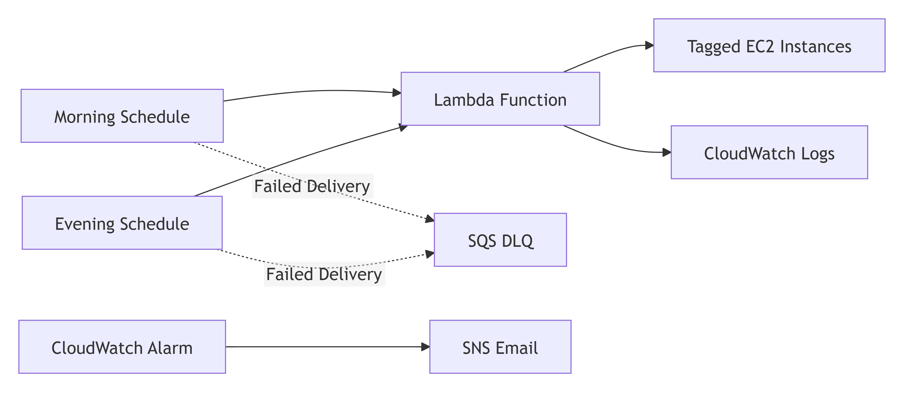

## Problem Statement

Development EC2 instances often run outside working hours, creating unnecessary cost.

## Solution

EventBridge Scheduler invokes a Python Lambda function that starts or stops tagged development instances.

## Architecture

EventBridge Scheduler → Lambda → EC2 → CloudWatch Logs

Failed schedule delivery → SQS DLQ

## Services Used

- AWS Lambda
- Amazon EventBridge Scheduler
- Amazon EC2
- AWS IAM
- Amazon CloudWatch
- Amazon SQS

## Security

- Dedicated Lambda execution role
- Tag-restricted start/stop permissions
- No EC2 full-access policy
- Input validation
- No credentials stored in code

## Deployment

Include console and Terraform deployment instructions.

## Testing

Include start, stop, invalid-input, and no-matching-instance tests.

## Monitoring

Include CloudWatch log group and Lambda error alarm details.

## Cleanup

Include resource deletion steps.

